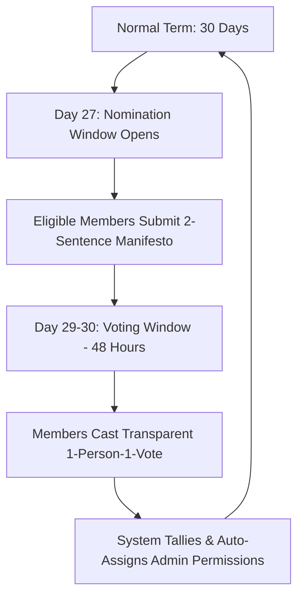

# 📄 PRODUCT PROPOSAL & RFC: SWAPIFHY COMMUNITIES
**Next-Gen Learning Micro-Communities with Democratic Governance & Real-Time Engagement**

---

| **Document Property** | **Details** |
| :--- | :--- |
| **Project** | Swapifhy Core Platform Upgrade (v2.1) |
| **Document Type** | Request For Comments (RFC) & Product Specification |
| **Target Audience** | Swapifhy Founders, Core Tech Team, Community Operations |
| **Current Status** | 🟡 **PROPOSED / READY FOR TEAM DISCUSSION** |
| **Primary Goal** | **3x-5x Day-30 User Retention, Eliminate "Empty Room" Churn, Drive Viral Community Growth** |

---

## 1. Executive Summary

Swapifhy has built a fast, seamless 1-on-1 peer skill exchange foundation. However, **pure 1-on-1 matchmaking suffers from a classic industry bottleneck: high friction and asynchronous lag.** 

When a user registers, picks their skills, and reaches out to a match, they often wait hours or days for a response. In that waiting period, **there is nothing to keep them on the platform**, resulting in churn.

**The Solution:** Introduce **Swapifhy Communities** — specialized, vibrant learning micro-communities (e.g., *Founders & Indie Hackers*, *Full-Stack & AI Developers*, *UI/UX Designers*, *Language Exchange*). 

These spaces combine the **instant messaging flow of WhatsApp Groups**, the **channel clarity of Discord/Slack**, and a **first-of-its-kind Democratic Governance System** where community leaders and admins are nominated and voted into office directly by the community, while the Swapifhy Core Team acts as Super Admin.

---

## 2. Problem Statement: Current Retention Bottlenecks

1. **The "Cold Start / Empty Room" Feeling:**
   - New users complete onboarding and land on an explore feed. Without active live conversations or social proof, the platform can feel quiet.
2. **Asynchronous Lag = Lost Momentum:**
   - 1-on-1 swapping requires scheduling calls on Google Meet or Zoom. While waiting, users have zero low-friction activities to engage with.
3. **Barter Coincidence of Wants:**
   - If User A wants to learn React from User B, but User B doesn't want User A's Graphic Design, the swap dies. In a community of 100+ members, User A can easily find 5 other people who want Graphic Design.
4. **Administrative Bottleneck:**
   - If the Swapifhy team has to moderate, curate, and lead every single topic, community scaling becomes a major manual operational burden.

---

## 3. The Proposed Solution: Swapifhy Communities Hub

A dedicated top-level section on the platform (`/communities`) that empowers users to join niche learning tribes, interact in real time, and elect their own leadership.

### Initial Launch Cohorts:
1. 🚀 **Founders & Indie Hackers** — *Pitch deck critiques, MVP feedback, user acquisition, monetization strategies.*
2. 💻 **Full-Stack & AI Engineers** — *Code reviews, debugging live, prompt engineering, modern architectures.*
3. 🎨 **UI/UX & Product Designers** — *Portfolio roasts, Figma design systems, wireframe feedback, usability.*
4. 🗣️ **Global Language Exchange** — *Casual conversation practice pods in English, Spanish, French, German, Hindi.*
5. 📈 **Growth & Content Creators** — *Personal branding, video editing, SEO, newsletters, organic marketing.*

---

## 4. Community Room Architecture (WhatsApp + Discord Hybrid)

When entering a community (e.g. `/communities/founders`), members access a focused multi-channel hub:

```
┌─────────────────────────────────────────────────────────────────────────────┐
│  🚀 FOUNDERS COMMUNITY   [● 64 Online]   Admin: @Aditya (Elected)   [Vote]  │
├──────────────────────────┬─────────────────────────────────┬────────────────┤
│ CHANNELS                 │ MAIN INTERACTIVE STAGE          │ COMMUNITY      │
│                          │                                 │ LEADERBOARD    │
│ 📢 #announcements        │ 🎙️ Live Audio Stage (Active)    │                │
│    (Admin Broadcasts)    │    "SaaS MVP Feedback Session"  │ 🥇 @Elena      │
│                          │    [Join Stage]  [✋ Raise Hand] │ 🥈 @Rahul      │
│ 💬 #general-discussion   │ ─────────────────────────────── │ 🥉 @Alex       │
│    (WhatsApp-Style Chat) │                                 │                │
│                          │ 💬 Real-Time Discussion Stream  │ RECENT SWAPS   │
│ 🤝 #swap-requests        │    (Typing indicators, voice    │ ⚡ 4 Swaps     │
│    (Instant SOS Needs)   │     notes, code snippets)       │    Completed   │
│                          │                                 │    Today       │
│ 🎯 #bounty-board         │ ─────────────────────────────── │                │
│    (Mini Challenges)     │                                 │ ONLINE MEMBERS │
│                          │ 📊 Daily Hot Take Debate:       │ ● Sarah (Figma)│
│ 📚 #resource-vault       │    "Bootstrapped vs VC in 2026" │ ● Kevin (Node) │
│    (Top Upvoted Links)   │    [Vote: 62% vs 38%]           │                │
└──────────────────────────┴─────────────────────────────────┴────────────────┘
```

### Channel Specifications:
- **📢 #announcements (Broadcast-Only):**
  - Only the **Swapifhy Super Admins** and the **Elected Community Admin** can post here.
  - Automatically triggers push notifications to all community members.
  - Used for milestone events, weekly AMAs, official updates, and election announcements.
- **💬 #general-discussion (Real-Time Group Stream):**
  - Real-time chat powered by WebSockets (Socket.IO).
  - Clean, modern WhatsApp-like experience: rich text, image attachments, code blocks, voice notes, and message replies.
- **🤝 #swap-requests (The Rapid Barter Exchange):**
  - High-intent channel: Members post immediate needs (*"Need 15 min help configuring Docker — will trade 30 min UI audit!"*).
  - 1-click **"Accept Swap"** button opens a direct DM between the two parties.
- **🎯 #bounty-board (Community Micro-Challenges):**
  - Members or Admins post weekly creative or technical challenges (*"Redesign this login modal"*).
  - Submissions are posted in-thread and upvoted by the community. Winners receive Karma Points and MVP badges.
- **📚 #resource-vault (Curated Knowledge):**
  - Any chat message that receives 5+ ⭐ (Star) reactions automatically pins to the Resource Vault.
  - Acts as a crowd-curated library of the best tutorials, templates, and tools.

---

## 5. Democratic Governance: Community Election Engine

To make communities self-sustaining and foster true user ownership, leadership is decentralized and democratic.

### Role Hierarchy & Permissions:

| Role | Who Holds It | Permissions & Capabilities |
| :--- | :--- | :--- |
| **👑 Super Admin** | **Swapifhy Core Team** | Global control, platform safety, veto power, can ban users across all rooms, feature communities. |
| **⭐ Elected Community Admin** | **Voted Member (Top Vote)** | Pin messages, post in #announcements, host Live Stage sessions, trigger elections, assign moderators. |
| **🛡️ Moderator** | **Appointed by Admin/Votes** | Delete spam, mute disruptive users, tag helpful resources into the Vault. |
| **👤 Member** | **Any Joined User** | Chat, post swap requests, vote in polls, submit bounties, vote in elections. |

### The Automated 30-Day Election Cycle:


1. **Eligibility Filter:** Only users with at least 3 completed swaps and a positive reliability rating can stand for election (prevents spammers and brand-new troll accounts).
2. **Election Ballot:** A clean, unmissable banner appears at the top of the community during voting days with candidates' bios and manifestos.
3. **Term Limit:** Admins hold office for 30 or 60 days. This keeps community leaders accountable, active, and fresh.

---

## 6. High-Dopamine Interactive Features (Never-Boring Engine)

1. **🎙️ "The Live Stage" (1-Click Voice/Audio Lounge):**
   - Built directly into the top of the community. The Admin can start an audio session (*"Founder AMA"* or *"Code Review Hour"*).
   - Members can listen in background tabs while working or tap **"✋ Raise Hand"** to speak.
2. **⚡ "Friday 15-Minute Speed Mixer" (Rapid Breakouts):**
   - A scheduled virtual mixer. When activated, online members are paired into 3-minute 1-on-1 audio chats to introduce their skills and break the ice.
3. **🏆 Weekly Community MVP Podium:**
   - Top 3 contributors (measured by swaps completed, answers given, and upvotes) are highlighted on an animated podium.
4. **📊 Daily Hot Take Debates:**
   - 1-click interactive polls with live updating pie charts and comment threads.

---

## 7. Technical Implementation Feasibility

The Swapifhy stack (Next.js, Node.js/Express, Prisma, PostgreSQL, Socket.IO, Web Push) is already **90% primed** for this feature:

### Proposed Database Models (Prisma):
```prisma
model Community {
  id          String            @id @default(uuid())
  slug        String            @unique
  name        String
  description String
  category    String
  avatar      String?
  coverImage  String?
  isOfficial  Boolean           @default(true)
  createdAt   DateTime          @default(now())
  members     CommunityMember[]
  channels    CommunityChannel[]
  elections   CommunityElection[]
}

model CommunityMember {
  id          String          @id @default(uuid())
  communityId String
  userId      String
  role        CommunityRole   @default(MEMBER) // SUPER_ADMIN, ELECTED_ADMIN, MODERATOR, MEMBER
  joinedAt    DateTime        @default(now())
  community   Community       @relation(fields: [communityId], references: [id])
  user        User            @relation(fields: [userId], references: [id])
  
  @@unique([communityId, userId])
}

model CommunityChannel {
  id          String          @id @default(uuid())
  communityId String
  name        String          // announcements, general, swap-board, bounties
  type        ChannelType     // ANNOUNCEMENT, CHAT, SWAP_BOARD, VAULT
  messages    CommunityMessage[]
}

model CommunityMessage {
  id          String          @id @default(uuid())
  channelId   String
  senderId    String
  content     String
  attachments Json?
  pinned      Boolean         @default(false)
  starCount   Int             @default(0)
  createdAt   DateTime        @default(now())
}

model CommunityElection {
  id          String          @id @default(uuid())
  communityId String
  status      ElectionStatus  // UPCOMING, NOMINATION, VOTING, COMPLETED
  startDate   DateTime
  endDate     DateTime
  winnerId    String?
  votes       CommunityVote[]
}
```

---

## 8. Success Metrics & Projected Business Impact

| Metric | Pre-Community Baseline | Post-Community Target |
| :--- | :--- | :--- |
| **Day-30 Retention (D30)** | Typical Peer-to-Peer ~12% | **Target: 35% - 45%** |
| **Average Daily Session Time** | 3.5 minutes | **18 - 25 minutes** (Audio Stage + Chat) |
| **Daily Active Users / MAU** | ~15% | **35%+** |
| **Organic Viral Coefficient (K-factor)** | ~0.4 | **1.2+** (Candidates invite friends to vote for them) |
| **Swaps Initiated per User** | 1.1 / month | **4.5 / month** (Frictionless community matching) |

---

## 9. Phased Rollout Roadmap

- **Phase 1 (Week 1–2): Core Community Hub & Chat MVP**
  - Deploy `/communities` directory with 4 official groups.
  - Implement `#announcements` and `#general-chat` with real-time Socket.IO messaging.
  - Super Admin moderation controls for Swapifhy core team.
- **Phase 2 (Week 3): Democratic Elections & Governance**
  - Build candidate nomination and 48-hour voting ballot.
  - Automated role assignment and admin badges.
- **Phase 3 (Week 4): Interactive Stage & Value Drivers**
  - Implement `#bounty-board`, `#resource-vault`, and Daily Polls.
  - Integrate Web Push alerts for community announcements.
- **Phase 4 (Future): Live Audio Stage & Friday Speed Mixer**
  - WebRTC lightweight audio room integration for live community talks.

---

## 10. Key Discussion Points for the Team Meeting

Before writing code, let's align on these key decisions:
1. **Initial Groups:** Do we launch with 3 curated communities (Founders, Devs, Designers) or allow user-created custom communities right away? *(Recommendation: Start with 3–5 curated official ones to concentrate liquidity).*
2. **Election Frequency:** Should Admin terms be **30 days** (fast, high engagement) or **60 days** (more stability)?
3. **Voting Eligibility:** Should every registered user be allowed to vote, or only users who completed onboarding & verified email? *(Recommendation: Email-verified + completed onboarding to prevent sockpuppeting).*
4. **Chat Features:** Should we support voice notes in Phase 1 or keep Phase 1 strictly text, code snippets, and image attachments?

---

*Prepared for review with the Swapifhy Executive & Engineering Team.*  
*Let's build the future of collaborative learning!*
